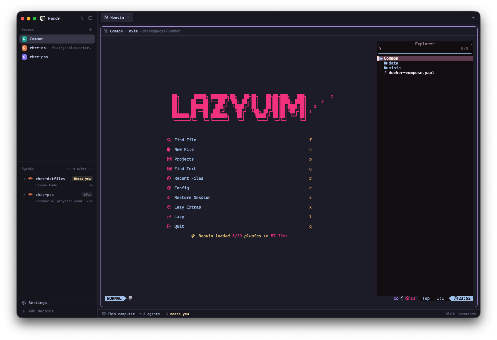

# chrc

A translucent Catppuccin Mocha window built for running several coding agents at once. On the left, a 268px sidebar shows spaces on top and a numbered agents list below, in the order the agents were opened and with each one's state spelled out ("Working", "Needs you", "Done", "Idle"). On the right, the active tab's panes float as rounded cards over a blurred desktop, with a tab bar above and a status bar below. `Ctrl+B` opens a tmux-style prefix with every shortcut grouped in columns and a `/` search; `Ctrl+B` then `a` opens a kanban board of all agents by state, driven with vim keys.

## What you see

Left to right:

1. **Sidebar** (268px, min 44, max 480, not drag-resizable, `chrome` background `#11111b73`):
   - **Brand bar** (46px, drags the window): the shipped `workspace-chrome` header (logo, search, sidebar toggle).
   - **Spaces** (half of the remaining height, min 90px): the shipped `spaces` list with colored initials and the git branch.
   - **Agents** (other half, min 90px): the `ordered-agents` mod.
     - Header row 41px: "Agents" (11.5px, medium, dim) on the left, "⌥1–9 after ^B" (11px, dim) on the right.
     - One card per agent, at least 48px tall, 8px radius, two lines:
       - Left: its number (1, 2, 3…, 11px, dim) and the program icon (16px).
       - Line 1: the space name (13px, foreground; muted when idle and not focused), a fold chevron if it has sub-agents, and a status pill on the right.
       - Line 2 (11px, dim): the tab's name or the agent's own title, the machine name for remote agents, and how long it has been in this state (`<1m`, `23m`, `4h`, `2d`).
     - The focused agent's card has the `selected` background (`#585b7099`).
     - Sub-agents hang under their parent as 26px tree rows with drawn tree lines.
   - **Footer** (69px): the shipped `workspace-chrome` footer (Settings, Add machine).
2. **Work column**:
   - **Tab bar** (42px, drags the window): the shipped `tabs` mod.
   - **Body**, with 8px padding and 8px gaps:
     - **Main**: the active tab's panes. Each pane is a card with a 1px `border` (`#cdd6f41f`) that turns `accent` (`#cba6f7`) when focused, 10px radius, 8px gaps, a transparent background, and a 30px `pane` header always shown on top.
     - **Side panel**: a hidden 368px panel (min 280, max 900) that stacks the shipped `files` and `changes` mods, `files` first.
   - **Status bar** (28px): the shipped `workspace-status` mod (machine, branch, agent count).

The whole window uses no titlebar, macOS traffic lights at (12, 16), window blur, terminal opacity 0.72, terminal padding 14×12, 1px `border` dividers, and the `catppuccin-mocha` theme with these color overrides: canvas `#00000000`, chrome `#11111b73`, background `#1e1e2e`, surface `#3132448c`, raised `#313244b3`, hover `#45475a80`, selected `#585b7099`, selection `#585b70`, popover `#1e1e2ef2`, border `#cdd6f41f`, input `#cdd6f433`, accent `#cba6f7`, foreground `#cdd6f4`.

## How it behaves

**Agent states.** On a sidebar card, the status pill is the word on a 15% tint of the theme's status color (10.5px, semibold, 18px tall, 5px radius):
- **working**: "Working"
- **blocked** (or error): "Needs you"
- **done**: "Done"
- **idle**: "Idle"

When the sidebar is narrower than 160px it becomes a rail: each row shows only the number and a compact glyph. That is a spinning 12px spinner for working, a "!" badge for blocked, a filled dot for done and a hollow ring for idle.

**Order never shuffles.** Agents are listed by when their terminal was opened: local terminals first by terminal number (`t4` before `t10`), then each remote machine by name. A state change never moves a card. `agent.next` / `agent.prev` follow this same order.

**Sidebar clicks.** Clicking a card focuses that agent's pane. Clicking the icon of an agent that has sub-agents folds or unfolds them, and so does the chevron. Clicking a sub-agent row focuses it if it has a pane, or peeks at it otherwise.

**Ctrl+B prefix popup** (top of the window, 64px down, 980×430):
- **Layout.** The title reads "Ctrl+B · waiting for a key". Shortcuts sit in five columns: Tabs, Panes, Spaces, Agents, App. Each row is the key in `accent`, then the label, then "↻" if the key repeats.
- **Numbered keys.** These are collapsed into summary rows: `0–9` Tab 1–10, `←↓↑→` Focus pane, `!–(` Space 1–9. `?` expands them into one row per key.
- **Keys:**
  - Tabs: `c` new tab, `T` rename, `X` close, `n`/`p` next/previous (repeat).
  - Panes: `v` split right, `-` or `"` split down, `x` close pane, `z` zoom, `h j k l` or arrows to focus (repeat), `H`/`L` swap (repeat).
  - Spaces: `]`/`[` next/previous (repeat), `N` new, `W` rename, `D` close.
  - Agents: `J`/`K` next/previous (repeat), `a` agents board, `⌥1–9` focus agent N (the sidebar's numbers).
  - App: `w`/`g` picker, `b` sidebar toggle, `s` settings, `q`/`d` minimize, `⌥g` lazygit in a new terminal.
- **Repeat window.** After a repeatable key the title reads "Repeat · 500 ms". For 500ms, repeatable keys work again without `Ctrl+B`, and other plain keys are typed into the focused terminal.
- **Leaving.** `Ctrl+B` again sends a literal `Ctrl+B` to the terminal. `Esc` or any unbound key closes the popup.
- **`/` search.** The title becomes `/query▏` and matches every key by its label or exact key, numbered and Alt keys included, with each match's group on the right. `↑↓` or `Ctrl+N/P` (or `Ctrl+J/K`) move the highlight, `Enter` runs it, `Backspace` edits, and `Esc` (or Backspace on an empty query) goes back to the grid.

**Agents board** (`Ctrl+B a`, a centered dialog 1040px wide and 70% of the window tall):
- **Columns.** Four, left to right: **Needs you**, **Working**, **Done**, **Idle**. Each has a colored dot, its label in the status color and a count. Inside a column, the most recently changed agent comes first. An empty column says "Nothing here".
- **Cards.** A 3px left edge in the status color. Line 1 has the sidebar number, the program icon and the space name (semibold). Line 2 has the tab name or title. Line 3 has "program · address". The focused agent's card uses the `selected` background.
- **Keys:**
  - `h`/`l` (or ←/→) move between columns, skipping empty ones.
  - `j`/`k` (or ↓/↑) move between cards; `g`/`G` go to the first/last card.
  - `Enter`, `o` or `Space` focus the selected agent and close the board.
  - `1–9` jump by sidebar number; clicking a card jumps too.
  - `Esc` or `q` closes the board.
- **Cursor.** The cursor is a 2px `accent` border. It follows its agent when that agent changes column.

## Built from

- **`layouts/chrc.json`**: a `row` with these children.
  - `sidebar`, a column: `brand` block (`workspace-chrome`), `sidebar-lists` column (`spaces` block and `agents` block, weight 1 each), `sidebar-footer` block (`workspace-chrome` with props `{ "footer": true }`).
  - `work`, a column: `tabs` block (`tabs`), `work-body` row, `status` block (`workspace-status`). The `work-body` row holds the `main` block (`content.tab: "active"` plus the pane settings above) and the `panel` column, which wraps a `panel-body` stack of `files` and `changes`.
- **Shipped mods used:** `workspace-chrome`, `spaces`, `tabs`, `pane`, `files`, `changes`, `workspace-status`.
- **`mods/ordered-agents`**: a clone of the shipped `agents` mod (0.1.16) with the sort menu, priority/space groups and pin-to-top removed.
  - Order and data: it sorts `agents()` by terminal number, hides sub-agents that a tree already shows, and calls `setAgentOrder(order)`. It publishes the order as `setShared("agents.order", addresses)`, but only when that list changed.
  - Status timing: it keeps each agent's last state change time in `localStorage` (`changed`).
  - Commands: `pane.focus`, `terminal.peek`, `terminal.pin` (only for migrating old pins), `layout.resize`.
  - Other reads: `terminals()`, `panes()`, `spaces()`, `focused()`, `layout()`.
- **`mods/tmux-prefix`**: an overlay-only mod (`place: none`, popup) opened by keys.
  - Inputs: it reads keys with `on_key_down` and loops on `nextCommand()` for the mod-scoped `tmux-prefix.send-prefix`.
  - Commands: `run(command, args)` for the bindings, `agent.focus` for `⌥1–9` (picking by `shared("agents.order")`, else by terminal number), `terminal.open` with argv `["lazygit"]`.
  - It runs the `hc keys <terminal> <key>` program to send the literal prefix and the keys typed in the repeat window.
- **`mods/agents-board`**: an overlay-only mod (`place: none`, `dialog`). It reads `agents()`, `spaces()` and `shared("agents.order")`, and calls `pane.focus` and `closeOverlay`.
- **`keys.json`**: `ctrl-b` → `mod.open:tmux-prefix` in `global` and `terminal`, and `ctrl-b` → `tmux-prefix.send-prefix` in `mod:tmux-prefix`.
- No art beyond the shipped `mods/workspace-chrome/*.svg` icons (spinner, chevrons).

## Watch out

- **Shared numbering.** `⌥1–9` and the board's numbers must match the sidebar, so all three read `shared("agents.order")`. `setShared` re-renders every mod, so write it only when the list changed, or the sidebar re-renders forever.
- **Sidebar sort.** The shipped `agents` mod defaults to its Priority sort, which reorders on every state change and broke "⌥1 = first card". That is why this layout uses its own clone.
- **Opening order.** It is approximated by the terminal number in the address (`t4`, `vps/t7`). Herdr exposes no creation timestamp.
- **gpui-kit methods.** There is no `line_clamp`; use `truncate()`. Check each style method against `gpui-kit.d.ts`.
- **Keys reach the terminal.** `Ctrl+B` has to be bound in both `global` and `terminal`, or the terminal program receives it.
- **Numbered keys.** `⌥1–9` needs Option to act as Alt (Settings → Keyboard), and the `!–(` space keys assume a US layout.
- **Lazygit.** `⌥g` assumes `lazygit` is installed.
- **Sizes and counts.** Only the first 9 agents get an Alt shortcut. The prefix columns are sized for a 980px popup; the numbered keys expanded with `?` scroll inside their column.
- **Theme.** The look depends on window blur and transparent colors; with blur off, the sidebar and canvas are just dark.

## Done when

- `herdr-app check` passes for `mods/ordered-agents`, `mods/tmux-prefix` and `mods/agents-board`, and `layout.switch {"name":"chrc"}` shows the sidebar, tab bar, rounded pane cards and status bar.
- With three agents running, the sidebar numbers them 1–3 in the order they were opened. When one finishes, its pill changes from "Working" to "Done" without the cards reordering.
- `Ctrl+B` then `⌥1` focuses the agent numbered 1 in the sidebar.
- `Ctrl+B` shows all five columns with no scrolling. `/split` lists "Split right" and "Split down", and `Enter` splits the pane.
- `Ctrl+B a` opens the board with each agent in its state's column. `l`, `j` and `Enter` move the cursor and focus the selected agent.
- `Ctrl+B` `Ctrl+B` sends a literal `Ctrl+B` to the focused terminal.
